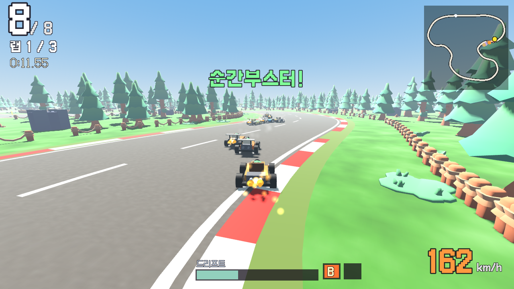

# 토이 레이싱

숲속에서 장난감 카트로 달리는 3D 레이싱 게임. 웹 브라우저에서 바로 할 수 있다.

**하러 가기: https://mhyoo-games.github.io/toy_racing/**

## 무엇을 할 수 있나

- **경주하기** — 컴퓨터 7명과 3바퀴. 순위에 따라 코인을 받는다.
- **혼자 연습** — 기록 도전. 처음 달리거나 기록을 깨면 코인.
- **둘이서** — 한 화면을 위아래로 나눠 둘이 경주 (컴퓨터를 같이 넣을 수도 있다).
- **친구와 온라인** — 서버 없이 브라우저끼리 바로 연결. 방장이 만든 초대 코드를 메신저로 보내고, 친구가 돌려준 답장 코드를 넣으면 연결된다. 방장이 트랙과 컴퓨터 참가를 고른다.
- **차고** — 모은 코인으로 카트를 산다. 카트 6종, 능력치(최고 속도·가속·핸들링·드리프트·부스터·무게)가 다르다.
- 트랙 3개: 도토리 숲길(쉬움) · 버섯 고개(보통) · 다람쥐 계곡(어려움). 길 위의 코인도 주울 수 있다.

## 달리는 기술

| 기술 | 하는 법 |
|---|---|
| 드리프트 | 굽이에서 방향키 + Shift. 미는 쪽으로 꺾고 있으면 계속 미끄러지고, 손을 떼면 천천히, 반대로 꺾으면 빨리 펴진다. 미끄러지는 동안 게이지가 차고, 가득 차면 부스터 +1 (두 개까지). 미끄러질 때 끼익 소리 |
| 부스터 | Ctrl(또는 Space). 잠깐 아주 빨라진다 |
| 순간부스터 | 드리프트가 끝나는 순간 화면에 ‘지금 ↑!’가 뜰 때 ↑를 다시 누른다 |
| 출발 부스터 | 출발 신호가 꺼지기 직전에 ↑를 누르고 있으면 빨리 튀어 나간다 |
| 인코스·아웃코스 | 굽이 안쪽을 스치면 길이 짧다. 컴퓨터도 안쪽을 노리니 바깥에서 들어가 안쪽을 찍자 |
| 커팅 | Shift를 짧게 톡 끊어 치면 속도를 거의 안 잃고 방향만 꺾인다(드리프트가 끝난 뒤 접지가 천천히 돌아오기 때문). 굽이마다 끊어 치며 안쪽을 파고들기 |
| 부스터 지름길 | 잔디는 느리지만 부스터를 쓰면 덜 느리다. 굽이 안쪽 잔디를 부스터로 가로지르기 |

## 조작

| | 달리기·핸들 | 드리프트 | 부스터 |
|---|---|---|---|
| 혼자 | 방향키 또는 WASD | Shift | Ctrl · Space |
| 둘이서 1P | WASD | 왼쪽 Shift | Space |
| 둘이서 2P | 방향키 | 오른쪽 Shift 또는 `/` | 오른쪽 Ctrl · Enter 또는 `.` |
| 게임패드 | 스틱·십자키, A·RT 가속, B·LT 브레이크 | X · RB | Y · LB |
| 휴대폰 | 화면 ◀ ▶ (가속은 저절로) | 드리프트 버튼 | 부스터 버튼 |

멈춤: Esc 또는 P

## 온라인 연결

1. 방장: **친구와 온라인 → 방 만들기** → 초대 코드 복사 → 메신저로 친구에게 보내기
2. 친구: **방 들어가기** → 초대 코드 붙여 넣고 확인 → 답장 코드 복사 → 방장에게 보내기
3. 방장: 답장 코드 붙여 넣고 **연결** → 트랙 고르고 **출발!**

WebRTC로 두 브라우저를 바로 잇는다(연결 주소를 찾을 때만 공개 STUN 서버를 쓴다). 회사·학교처럼 막힌 네트워크에서는 연결이 안 될 수 있다. 각자 자기 카트를 몰고 위치를 1초에 20번 주고받으며, 컴퓨터 카트는 방장 쪽에서 몰아 보낸다.

## 만든 방법

- Godot 4.6 (GDScript, GL Compatibility) → 웹으로 내보내 GitHub Pages에 올린다.
- 주행 규칙(카트 물리·드리프트·부스터·랩·순위·레이싱 라인·컴퓨터·상점·저장)은 `scripts/rules.gd`에 화면과 떨어뜨려 두고 `tests/run_tests.gd`로 확인한다. 테스트에서 컴퓨터가 모든 트랙을 3바퀴 돈다.
- 트랙은 `data/tracks.json`의 조절점을 곡선으로 이어 도로·연석·울타리·숲을 코드로 만든다. 카트는 `data/karts.json`의 모양 값으로 코드에서 조립한다.
- 소리와 곡은 `tools/sound/gen.py`가 코드로 합성한다 (음원 파일을 가져오지 않음).

## 그림·글꼴

- 나무·바위·울타리·깃발·텐트·운전수: [Kenney Mini Forest](https://kenney.nl) (CC0) — `assets/forest/LICENSE.txt`
- 글꼴: 갈무리 (SIL OFL) — `assets/fonts/LICENSE.txt`
